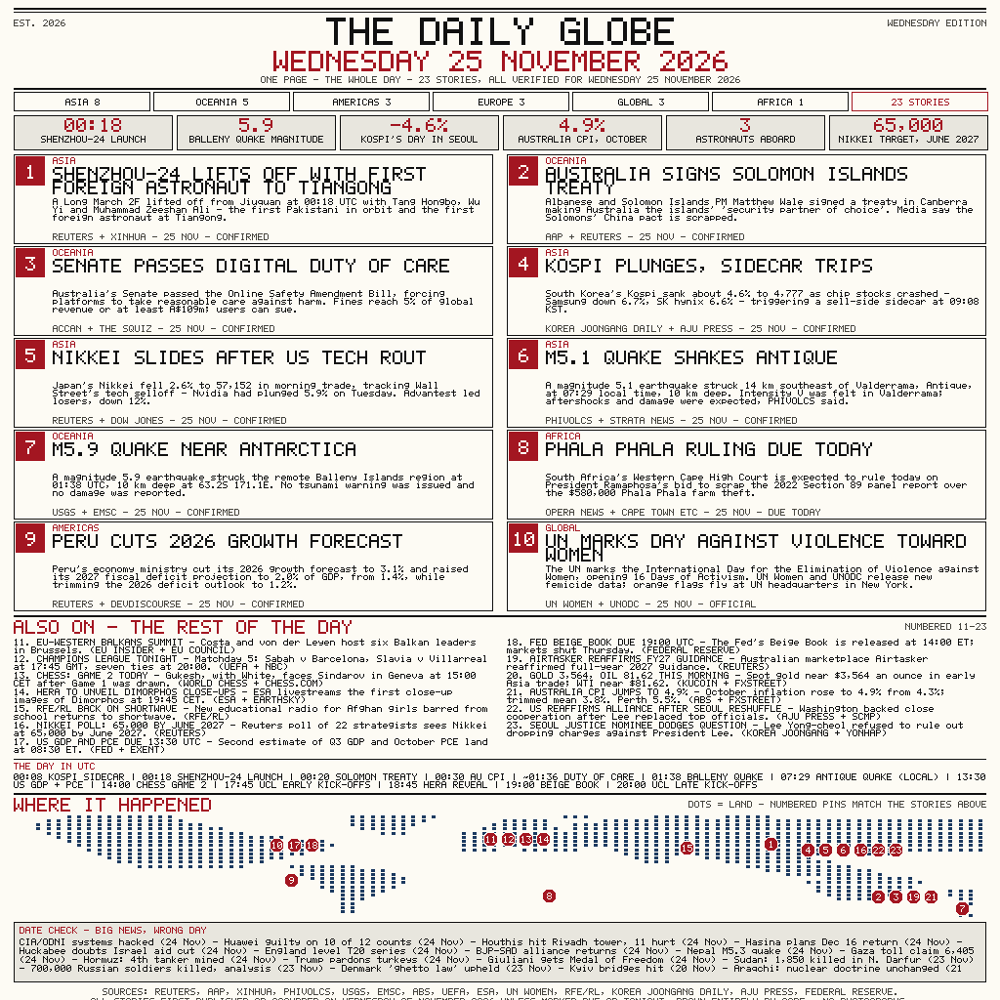

# The Daily Globe — Wednesday 25 November 2026

[](https://make.fun/bounty/news-image-20261125)
[](https://make.fun/bounty/news-image-20261125)
[](https://make.fun/bounty/news-image-20261125)

A one-page newspaper that sums up the world news of **Wednesday 25
November 2026** in a single 1024×1024 image. Entry for the
[make.fun bounty news-image-20261125](https://make.fun/bounty/news-image-20261125).



## What is on the page

- **10 feature stories** (numbered 1–10): Shenzhou-24 lifts off with the
  first foreign astronaut to Tiangong; the Australia–Solomon Islands treaty;
  Australia's Digital Duty of Care; the Kospi plunge; the Nikkei slide;
  two earthquakes (Antique M5.1, Balleny Islands M5.9); the Phala Phala
  ruling due today; Peru's growth cut; and the UN day against violence
  toward women.
- **13 more stories** in ALSO ON (11–23): the EU–Western Balkans summit,
  Champions League matchday 5, World Chess Championship game 2, ESA's
  Hera Dimorphos reveal, RFE/RL back on shortwave, the Nikkei poll,
  US GDP/PCE and the Fed Beige Book, Airtasker, gold and oil, Australia CPI,
  and Seoul's cabinet reshuffle fallout.
- **THE DAY IN NUMBERS** (6 figures from the day), **THE DAY IN UTC**
  (time rail), a dotted world map (**WHERE IT HAPPENED**) with numbered
  pins, and a **DATE CHECK** box listing big stories that are *not* from
  25 November — so nothing from another day is passed off as today's news.

Every story was verified against at least two independent outlets whose
publication dates agree on 25 November 2026, or is an event scheduled for
that day (marked DUE / TONIGHT).

## How to run

```sh
python3 -P -s main.py            # writes /output/entry.png
python3 -P -s main.py entry.png # or any path you choose
```

Pure Python standard library — no Pillow, no network, no randomness, no
timestamps. The program draws everything itself (including its own 5×7
bitmap font and PNG encoder) and is fully deterministic: two runs write
byte-identical files.

Verified: 1024×1024 PNG, 45,620 bytes, two runs with identical SHA-256,
worst-case run ~0.8 s (sandbox budget is 60 s).

## Sources

Reuters, AAP, Xinhua, PHIVOLCS, USGS, EMSC, ABS, UEFA, ESA, UN Women,
RFE/RL, Korea JoongAng Daily, Aju Press, Federal Reserve, FXStreet,
World Chess, Chess.com, EarthSky, SCMP, Yonhap.

Note: the Phala Phala ruling had not been delivered when this page was
built (the Western Cape High Court sits from about 08:00 UTC), so story 8
is worded as "due today". The Shenzhou-24 docking was likewise scheduled,
not yet confirmed, at build time.
